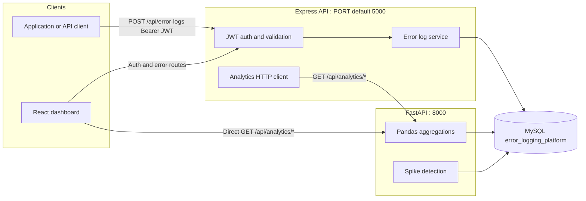
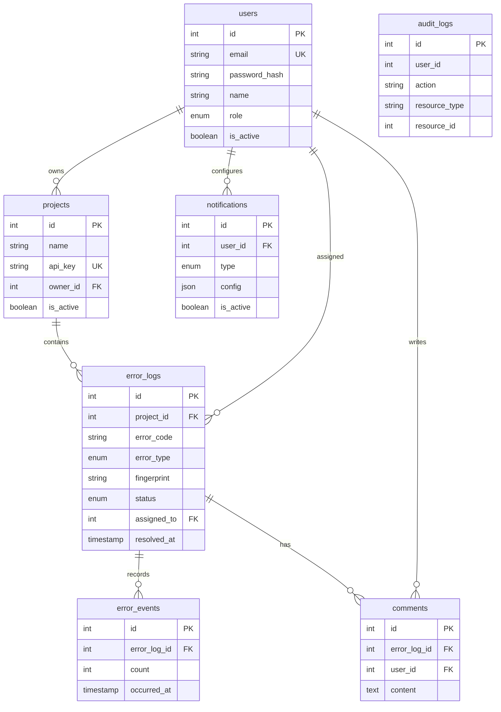

# LogSentinel

**Intelligent Application Error Logging, Monitoring & Analytics Platform**

Capture. Analyze. Monitor. Resolve.

LogSentinel is a multi-service error logging platform. A React dashboard and an Express API store application errors in MySQL. A separate FastAPI service reads that same database to build severity trends, route breakdowns, and statistical spike reports.

[](https://nodejs.org/)
[](https://expressjs.com/)
[](https://react.dev/)
[](https://www.python.org/)
[](https://fastapi.tiangolo.com/)
[](https://www.mysql.com/)
[](https://docs.docker.com/compose/)

Repository: [github.com/samalarakshithbabu/Error-Logging-Platform](https://github.com/samalarakshithbabu/Error-Logging-Platform)

There is no public deployment, so this README does not include a live demo badge. The GitHub repository name remains `Error-Logging-Platform`. The product name in this documentation is LogSentinel.

## Contents

1. [Project overview](#1-project-overview)
2. [Problem statement](#2-problem-statement)
3. [Key features](#3-key-features)
4. [Application screenshots](#4-application-screenshots)
5. [System architecture](#5-system-architecture)
6. [Technology stack](#6-technology-stack)
7. [Project structure](#7-project-structure)
8. [Application workflow](#8-application-workflow)
9. [Installation and setup](#9-installation-and-setup)
10. [Environment variables](#10-environment-variables)
11. [API documentation](#11-api-documentation)
12. [Database architecture](#12-database-architecture)
13. [Analytics and monitoring](#13-analytics-and-monitoring)
14. [Testing](#14-testing)
15. [Docker and deployment](#15-docker-and-deployment)
16. [Security](#16-security)
17. [Limitations](#17-limitations)
18. [Future enhancements](#18-future-enhancements)
19. [Author and license](#19-author-and-license)

---

## 1. Project overview

LogSentinel gives an engineering team one place to record failures, classify them by severity, and inspect how often they occur.

An external application, or an authenticated user, posts an error to the Express API. The API validates the payload, stores the message, stack trace, request context, and a fingerprint in MySQL, and returns the new log id. The React UI is written to list those logs, open a detail view, and chart trends from the FastAPI analytics service.

The project is useful for backend and full-stack practice: REST design, JWT authentication, relational modeling, a second analytics process, and Docker Compose service layout. It is a portfolio implementation of an error inbox, not a hosted observability product.

**Who it is for**

- Developers who want a small, readable monitoring stack to study or extend.
- Teams that need a schema and API for centralized error intake before adopting a commercial tool.
- Reviewers evaluating API design, MySQL modeling, and service boundaries.

---

## 2. Problem statement

Application failures are hard to manage when each service writes its own logs.

- Messages sit in separate files or consoles, so the same failure is easy to miss.
- Severity is inconsistent, so critical failures look the same as noise.
- The same exception can fire thousands of times and bury the first useful stack trace.
- Debugging starts with searching raw logs instead of opening one record with request context.
- There is no shared view of which project, route, or environment is failing.
- Counts over time are manual, so a sudden rise in errors is noticed late.

LogSentinel addresses that by storing structured error records in MySQL and exposing them through an API and a dashboard.

---

## 3. Key features

The lists below come from the current source. A screen or table existing in the repository is not treated as a finished integration.

### Implemented and verified in source

These behaviors are present in the Express API and MySQL schema. They were confirmed by reading the route, controller, and service code. They were not executed against a running database for this document.

| Capability | Where it lives |
| --- | --- |
| Centralized error intake | `POST /api/error-logs` inserts into `error_logs` |
| Five severity levels | `critical`, `high`, `medium`, `low`, `info`, validated with `express-validator` and stored in `error_type` |
| Stack trace and request context | `stack_trace`, URL, method, IP, user agent, params, headers, environment, version, metadata |
| Filtering and pagination on the API | Query filters for level, status, route, date range, project id, and message or error-code search. Page size is capped at 100 |
| Status workflow | `new`, `investigating`, `resolved`, `ignored`. Resolving sets `resolved_at` |
| Comments | Insert and list comments joined to the author name |
| Summary counts | Totals by severity, distinct fingerprints, and distinct request URLs for the last 7 days, plus five recent critical or high rows |
| JWT authentication | Register, login, `GET /api/auth/me`, and token refresh. Passwords are hashed with bcrypt (cost 10) |
| Admin-only delete | `DELETE /api/error-logs/:id` returns 403 unless `req.user.role` is `admin` |
| Rate limiting | Auth routes: 10 requests per 15 minutes. Error and analytics routes use the configured window and max |
| HTTP hardening | `helmet` on the Express app |
| Analytics queries in Python | FastAPI routes aggregate MySQL rows with pandas for hourly and daily counts, routes, severity, top routes, spikes, trend, and a 7-day summary |
| Spike calculation | Mean and standard deviation by hour-of-day and severity, compared with the last hour (`analytics/app/services/anomaly_detection.py`) |
| Schema support for multiple projects | `projects` table with `owner_id` and `api_key`. Error rows reference `project_id` |
| Sample data and archive SQL | `database/seed.sql`, `database/archive.sql` |

### Partially implemented

| Capability | What exists | What is missing |
| --- | --- | --- |
| React dashboard | Pages for login, register, dashboard, error list, error detail, analytics, projects, and settings | `frontend/src/index.js` is not in the repository, so Create React App has no entry file. Several pages call API helpers that `frontend/src/services/api.js` does not export |
| Duplicate detection | `errorLogsService` hashes `message`, `route`, and `errorType` with MD5 and looks up `fingerprint` | The duplicate branch updates `occurrence_count` and `last_occurrence`, and those columns are not in `database/schema.sql`. The fingerprint input uses `errorType`, while create stores `level`, so the type portion is empty |
| Multi-project monitoring | Errors can be stored and filtered by `project_id`. Seed data includes three projects | There is no projects router. `frontend/src/pages/Projects.js` calls `projectsAPI`, which is not defined. API keys are stored and displayed in the UI design, and the ingest API does not authenticate with them |
| Error analytics dashboard | Chart.js page and `frontend/src/charts/ErrorCharts.js` | `Analytics.js` calls `analyticsAPI.getTimeline` and `analyticsAPI.exportData`, which are not defined. It also expects a response shape (`byType`, `total`, `resolved`) that the FastAPI summary does not return. FastAPI query names are `project_id`; the clients send `projectId` |
| Express-to-FastAPI proxy | `backend/src/services/analyticsService.js` calls FastAPI with axios and returns a JSON error object if the call fails | Same `projectId` / `project_id` mismatch. `GET /api/analytics/comparison` on Express returns a hard-coded zero payload and does not call FastAPI |
| Role-based access control | Roles exist on `users` (`admin`, `developer`, `viewer`). `authorize()` is implemented. Delete checks admin | `authorize()` is not applied to routes. Registration accepts a client-supplied `role`, including `admin`. Protected pages do not pass `allowedRoles` |
| Real-time monitoring | Nginx has a `/ws` proxy and `.env.example` defines `REACT_APP_WS_URL` | The Express app does not open a WebSocket server or push updates |
| Notifications | `notifications` table allows `email`, `slack`, and `webhook`. Settings shows email checkboxes | No mailer, Slack client, or webhook sender. The checkboxes are not saved |
| Redis | Compose starts Redis 7. Python `requirements.txt` includes `redis` | No application file creates a Redis client |
| Log export | Analytics page has JSON and CSV buttons | No export function and no export route |
| User management | `backend/src/routes/userRoutes.js` describes list, get, update, delete, and projects | `userController` does not exist, and `app.js` does not mount the router. Settings calls `usersAPI` and `authAPI.changePassword`, which are not implemented |
| Frontend and backend field names | Both sides know severity, status, and search | The error list sends `error_type`. The API filter reads `level` |

### Planned enhancements

These are not implemented. See [Future enhancements](#18-future-enhancements).

- Working email, Slack, and webhook delivery
- API-key authentication for ingest
- Live updates over WebSockets
- Export of error logs
- Enforced role checks on every mutating route
- A wired project-management API

---

## 4. Application screenshots

The repository has no `screenshots` directory and no image files. Nothing below is a screenshot. Each row is a placeholder for a capture that still needs to be added.

| Screen | Source page | Status |
| --- | --- | --- |
| Main dashboard | `frontend/src/pages/Dashboard.js` | Screenshot not in the repository |
| Error monitoring page | `frontend/src/pages/ErrorLogs.js` | Screenshot not in the repository |
| Error details and stack traces | `frontend/src/pages/ErrorDetail.js` | Screenshot not in the repository |
| Severity analytics | `frontend/src/pages/Analytics.js` | Screenshot not in the repository |
| Project management | `frontend/src/pages/Projects.js` | Screenshot not in the repository |
| Notification settings | `frontend/src/pages/Settings.js` (Preferences tab) | Screenshot not in the repository |

---

## 5. System architecture

The verified request path is HTTP in, MySQL out. FastAPI is a second reader of MySQL. Redis and notification providers are drawn only as unused or schema-only pieces, because no service calls them.



| Component | Purpose in this repository |
| --- | --- |
| React UI | Login, registration, protected routes, error pages, charts, project and settings screens. Entry file `src/index.js` is absent |
| Express API | Auth, validation, rate limits, error persistence, comments, summary, and a proxy to FastAPI |
| MySQL | Users, projects, error logs, occurrence events, comments, notification config, and audit rows |
| FastAPI | Read-only analytics and spike math over `error_logs`. Endpoints are unauthenticated |
| Redis | Started by Docker Compose. No application client |
| Notifications | Table and settings checkboxes only. No outbound integration |

Express analytics routes are optional for the UI. `frontend/src/services/api.js` calls FastAPI directly for charts and calls Express for auth and error logs.

---

## 6. Technology stack

| Area | Technology | Evidence |
| --- | --- | --- |
| Frontend | React 18, React Router 6, React Hook Form, Axios, Chart.js, react-chartjs-2, jwt-decode, date-fns | `frontend/package.json` |
| Frontend delivery | Create React App (`react-scripts` 5) in development. Nginx serves the production build in Docker | `frontend/package.json`, `frontend/Dockerfile`, `frontend/nginx.conf` |
| Backend | Node.js 18+, Express 4, Helmet, CORS, express-validator, express-rate-limit, bcryptjs, jsonwebtoken, mysql2, Axios, dotenv | `backend/package.json`, `backend/src` |
| Languages | JavaScript (UI and API), Python (analytics), SQL (schema) | Repository layout |
| Database | MySQL 8, InnoDB, utf8mb4 | `database/schema.sql`, `docker-compose.yml` |
| Cache | Redis 7 Alpine is defined in Compose. Application code does not use it | `docker-compose.yml` |
| Analytics | FastAPI 0.109, Uvicorn, SQLAlchemy 2, PyMySQL, pandas, NumPy | `analytics/requirements.txt`, `analytics/app` |
| Authentication | JWT bearer tokens, bcrypt password hashes, roles on the user row | `backend/src/routes/authRoutes.js`, `backend/src/middleware/auth.js` |
| Containerization | Dockerfiles for backend, frontend, and analytics. Compose also defines MySQL and Redis | `docker-compose.yml` |
| Testing libraries | Jest and Supertest are devDependencies. pytest, pytest-asyncio, and pytest-cov are in the Python requirements. No test files are present | `backend/package.json`, `analytics/requirements.txt` |
| Deployment described in-repo | Docker Compose on a single host. No cloud, Kubernetes, or CI workflow files | `docker-compose.yml` |

Declared and not used in source: `winston`, `morgan`, and `uuid` on the backend; the Python `redis` and `alembic` packages; `httpx` except as a listed dependency.

---

## 7. Project structure

```
Error-Logging-Platform/
├── .env.example
├── .gitignore
├── docker-compose.yml
├── backend/
│   ├── Dockerfile
│   ├── package.json
│   └── src/
│       ├── app.js
│       ├── config/          # env config and mysql2 pool
│       ├── controllers/     # error logs and analytics
│       ├── middleware/      # JWT, validation, rate limit, error handler
│       ├── routes/          # auth, error logs, analytics, unmounted user routes
│       ├── services/        # SQL for logs; axios client for FastAPI
│       └── utils/helpers.js
├── analytics/
│   ├── Dockerfile
│   ├── requirements.txt
│   └── app/
│       ├── main.py
│       ├── config.py
│       ├── database.py
│       ├── models.py
│       ├── routes/          # /api/analytics and /api/errors
│       └── services/        # aggregations and spike detection
├── frontend/
│   ├── Dockerfile
│   ├── nginx.conf
│   ├── package.json
│   ├── public/index.html
│   └── src/
│       ├── App.js
│       ├── components/
│       ├── context/
│       ├── charts/ErrorCharts.js
│       ├── pages/
│       ├── services/api.js
│       ├── hooks/useDebounce.js
│       └── utils/format.js
└── database/
    ├── schema.sql
    ├── seed.sql
    └── archive.sql
```

There is no `tests/` directory, no `LICENSE` file, and no screenshot folder. `backend/src/routes/userRoutes.js` is not mounted. `frontend/src/index.js` is not in the tree.

| Path | Role |
| --- | --- |
| `backend/src/app.js` | Express app, `/health`, route mounting, listen |
| `backend/src/services/errorLogsService.js` | Filters, insert, fingerprint, summary SQL |
| `analytics/app/main.py` | FastAPI app and router prefixes |
| `frontend/src/services/api.js` | Axios client actually used by some pages |
| `database/schema.sql` | Tables, indexes, `error_statistics` view, update triggers |
| `docker-compose.yml` | MySQL, Redis, backend, analytics, frontend |

---

## 8. Application workflow

1. An application, or a logged-in user, has an exception with a message and a severity.
2. The caller obtains a JWT from `POST /api/auth/login` or `POST /api/auth/register`. There is no separate ingest key check.
3. The caller sends `POST /api/error-logs` with `Authorization: Bearer <token>`.
4. Validation requires `level` (`critical`, `high`, `medium`, `low`, or `info`) and a non-empty `message`. Optional fields include stack, route, method, project id, request params, headers, environment, version, and metadata.
5. The service builds an MD5 fingerprint and inserts a row. On a matching fingerprint it tries to increment occurrence columns that the schema does not define, so that branch does not match the current table.
6. MySQL stores the row in `error_logs`. Comments and status changes are separate authenticated requests. `error_events` is not written by the API.
7. Analytics are generated when a client calls FastAPI, or when an Express analytics route successfully proxies to FastAPI. Both read `error_logs` directly. The dashboard does not subscribe to a stream.
8. The React pages are intended to show the list, the detail view, and charts. Several of those pages call functions that are not exported, so the UI path is incomplete.
9. Notifications are not sent. Nothing in the request path reads the `notifications` table.

---

## 9. Installation and setup

Commands below match the files in this repository. They were not run as a full stack while writing this README. Read [Limitations](#17-limitations) before expecting `npm start` or `docker compose up` to serve a working UI.

### Prerequisites

- Node.js 18 or newer and npm
- Python 3.10 or newer
- MySQL 8.0 client and server
- Git

Redis is not required for the current application code.

### Clone

```bash
git clone https://github.com/samalarakshithbabu/Error-Logging-Platform.git
cd Error-Logging-Platform
```

The same two commands work in Windows PowerShell and in bash.

### Database

Create the schema and optional sample rows. The seed file inserts example users, projects, and errors. Its password hashes are placeholders, not known login passwords. Create an account with the register API instead of trying those seed emails.

**Linux and macOS**

```bash
mysql -u root -p < database/schema.sql
mysql -u root -p < database/seed.sql
```

**Windows PowerShell**

```powershell
Get-Content .\database\schema.sql -Raw | mysql -u root -p
Get-Content .\database\seed.sql -Raw | mysql -u root -p
```

`archive.sql` creates stored procedures. It is optional and is not loaded by Compose.

`npm run db:migrate` and `npm run db:seed` call `node src/config/database.js` with an argument. That file only exports a connection pool, so those scripts are not a migration runner.

### Backend

The API reads `PORT`, not `APP_PORT`. The default in code is **5000**. The React client also defaults to `http://localhost:5000`. `dotenv` loads `.env` from the process working directory, so keep the file in `backend/`.

**Linux and macOS**

```bash
cp .env.example backend/.env
cd backend
npm install
npm run dev
```

**Windows PowerShell**

```powershell
Copy-Item .env.example backend\.env
cd backend
npm install
npm run dev
```

Then edit `backend/.env` and set at least:

```env
PORT=5000
NODE_ENV=development
DB_HOST=localhost
DB_PORT=3306
DB_USER=root
DB_PASSWORD=your-password
DB_NAME=error_logging_platform
JWT_SECRET=replace-with-a-long-random-string
FRONTEND_URL=http://localhost:3000
ANALYTICS_URL=http://localhost:8000
```

`npm run dev` uses nodemon. `npm start` runs `node src/app.js`.

Health check: `http://localhost:5000/health`

### Analytics service

`analytics/app/config.py` imports `dotenv`, and `python-dotenv` is not listed in `requirements.txt`. Install it before starting the service. Run Uvicorn from the `analytics` directory so the `app` package imports resolve.

**Linux and macOS**

```bash
cd analytics
python3 -m venv venv
source venv/bin/activate
pip install -r requirements.txt
pip install python-dotenv
uvicorn app.main:app --reload --host 0.0.0.0 --port 8000
```

**Windows PowerShell**

```powershell
cd analytics
python -m venv venv
.\venv\Scripts\Activate.ps1
pip install -r requirements.txt
pip install python-dotenv
uvicorn app.main:app --reload --host 0.0.0.0 --port 8000
```

Set `DB_HOST`, `DB_PORT`, `DB_USER`, `DB_PASSWORD`, and `DB_NAME` in the environment or in `analytics/.env`. The service builds its own SQLAlchemy URL from those variables. It does not read `DATABASE_URL`.

Health check: `http://localhost:8000/health`  
Interactive docs: `http://localhost:8000/docs`

### Frontend

Create React App serves the dev server on port 3000. The Axios base URL must be the backend origin **without** an `/api` suffix, because the client already prefixes `/api/...`.

`frontend/src/index.js` is missing. `npm start` cannot mount the React tree until that entry file exists. The commands below are still the ones defined by `frontend/package.json`.

**Linux, macOS, and Windows PowerShell**

```bash
cd frontend
npm install
npm start
```

**Linux and macOS, with the API URL set for one shell**

```bash
export REACT_APP_API_URL=http://localhost:5000
export REACT_APP_ANALYTICS_URL=http://localhost:8000
npm start
```

**Windows PowerShell**

```powershell
$env:REACT_APP_API_URL = "http://localhost:5000"
$env:REACT_APP_ANALYTICS_URL = "http://localhost:8000"
npm start
```

Intended addresses once each process is actually listening:

| Service | URL |
| --- | --- |
| React dev server | `http://localhost:3000` |
| Express API | `http://localhost:5000` |
| FastAPI | `http://localhost:8000` |

Set `FRONTEND_URL` on the backend to the React origin. The CORS default is `http://localhost:3000`.

---

## 10. Environment variables

Values below are names and roles only. Do not commit real passwords or a production JWT secret. `.env` is gitignored.

The root template is `.env.example`. Code does not read every name in that file.

### Read by the Express API

| Variable | Used for | Default in code |
| --- | --- | --- |
| `PORT` | Listen port | `5000` |
| `NODE_ENV` | Dev request logging. Also the default error `environment` when the body omits it | `development` |
| `DB_HOST` | MySQL host | `localhost` |
| `DB_PORT` | MySQL port | `3306` |
| `DB_USER` | MySQL user | `root` |
| `DB_PASSWORD` | MySQL password | empty string |
| `DB_NAME` | Database name | `error_logging_platform` |
| `DB_POOL_MIN` | Present on the config object | `2` |
| `DB_POOL_MAX` | mysql2 `connectionLimit` | `10` |
| `DB_CONN_TIMEOUT` | Stored as `idleTimeoutMillis` on the config object. The pool itself does not pass it through | `10000` |
| `JWT_SECRET` | HMAC secret for access tokens | `default-secret-change-in-production` |
| `JWT_EXPIRES_IN` | Access token lifetime | `24h` |
| `JWT_REFRESH_SECRET` | Loaded only. Refresh uses `JWT_SECRET` | `refresh-secret` |
| `JWT_REFRESH_EXPIRES_IN` | Loaded only | `7d` |
| `FRONTEND_URL` | CORS origin | `http://localhost:3000` |
| `RATE_LIMIT_WINDOW_MS` | Rate-limit window | `900000` |
| `RATE_LIMIT_MAX_REQUESTS` | Max requests per window for error and analytics routes | `100` |
| `ANALYTICS_URL` | Base URL of FastAPI | `http://localhost:8000` |

`JWT_REFRESH_SECRET` and `ANALYTICS_URL` are not in `.env.example`. Add them yourself if you do not want the defaults.

### Read by the React client

| Variable | Used for | Default in code |
| --- | --- | --- |
| `REACT_APP_API_URL` | Axios `baseURL`. Must not include `/api` | `http://localhost:5000` |
| `REACT_APP_ANALYTICS_URL` | FastAPI origin | `http://localhost:8000` |

`.env.example` sets `REACT_APP_API_URL` to `http://localhost:3000/api`. That value does not match the client. `.env.example` also sets `REACT_APP_WS_URL`. No frontend file reads it.

Create React App only inlines `REACT_APP_*` variables that are present when `npm start` or `npm run build` runs.

### Read by the FastAPI service

| Variable | Used for | Default in code |
| --- | --- | --- |
| `DB_HOST` | MySQL host | `localhost` |
| `DB_PORT` | MySQL port | `3306` |
| `DB_USER` | MySQL user | `root` |
| `DB_PASSWORD` | MySQL password | `password` |
| `DB_NAME` | Database name | `error_logging_platform` |
| `ANALYTICS_HOST` | Uvicorn host when `main.py` is executed directly | `0.0.0.0` |
| `ANALYTICS_PORT` | Uvicorn port when `main.py` is executed directly | `8000` |
| `ANALYTICS_DEBUG` | Uvicorn reload when `main.py` is executed directly | `false` |
| `SPIKE_THRESHOLD_MULTIPLIER` | Spike threshold is mean plus this times std | `3.0` |
| `SPIKE_MIN_ERROR_COUNT` | Minimum count before a spike is reported | `10` |
| `SPIKE_BASELINE_HOURS` | History window used to build the baseline | `24` |
| `SPIKE_WINDOW_MINUTES` | Loaded in config. The detector uses a fixed one-hour query | `60` |

### Present in `.env.example` or Compose and not read by application code

| Variable | Notes |
| --- | --- |
| `APP_PORT`, `BACKEND_PORT` | The API uses `PORT` |
| `REDIS_HOST`, `REDIS_PORT`, `REDIS_PASSWORD`, `REDIS_URL` | Compose injects them. No client reads them |
| `SMTP_HOST`, `SMTP_PORT`, `SMTP_USER`, `SMTP_PASSWORD` | No mail sender |
| `LOG_LEVEL`, `LOG_FILE_PATH` | No logger is configured in source |
| `DATABASE_URL` | Set on the analytics container. The Python app builds a URL from `DB_*` |

---

## 11. API documentation

Routes below are the ones registered in `backend/src/app.js` and `analytics/app/main.py`. User routes are omitted because they are not mounted.

Express error and analytics routes expect:

```http
Authorization: Bearer <token>
Content-Type: application/json
```

FastAPI analytics and error routes do not check a token.

### Express authentication

| Method | Endpoint | Auth | Description | Body |
| --- | --- | --- | --- | --- |
| `POST` | `/api/auth/register` | No | Create a user and return a JWT. Rate limited | `email`, `password` (min 8), `name`. Optional `role` |
| `POST` | `/api/auth/login` | No | Check bcrypt hash and return a JWT. Inactive users are rejected | `email`, `password` |
| `GET` | `/api/auth/me` | Bearer | Return `id`, `email`, `name`, `role`, `is_active`, `created_at` | None |
| `POST` | `/api/auth/refresh` | Bearer | Sign a new token from the current token payload | None |

Register request:

```json
{
  "name": "Samala Rakshith Babu",
  "email": "rakshith@example.com",
  "password": "a-strong-password"
}
```

Register response (`201`):

```json
{
  "message": "User registered successfully",
  "token": "<jwt>",
  "user": {
    "id": 1,
    "email": "rakshith@example.com",
    "name": "Samala Rakshith Babu",
    "role": "developer"
  }
}
```

If `role` is omitted, the API stores `developer`. Validation failures return `400` with an `errors` array. Duplicate email returns `400` with `Email already registered`.

Login response (`200`) uses `message: "Login successful"` and the same `token` and `user` fields. Invalid credentials return `401`.

`GET /api/auth/me` returns the user row, not a wrapper object. `POST /api/auth/refresh` returns `{ "token": "<jwt>" }`.

### Express error logs

All of these require a bearer token and pass through the API rate limiter.

| Method | Endpoint | Description | Body or query |
| --- | --- | --- | --- |
| `GET` | `/api/error-logs` | Paginated list | Query: `page`, `limit` (1–100), `level`, `status`, `route`, `startDate`, `endDate`, `projectId`, `search` |
| `GET` | `/api/error-logs/summary` | Seven-day counts and five recent critical or high rows | Query: optional `projectId` |
| `GET` | `/api/error-logs/:id` | One log with project name and assignee name | None |
| `POST` | `/api/error-logs` | Validate and insert | JSON below |
| `PATCH` | `/api/error-logs/:id/status` | Set status. `resolved` also sets `resolved_at`. The caller is written to `assigned_to` | `{ "status": "investigating" }` |
| `POST` | `/api/error-logs/:id/comments` | Add a comment as the current user | `{ "content": "Looking at the pool timeout." }` |
| `GET` | `/api/error-logs/:id/comments` | Comments with `user_name`, newest first | None |
| `DELETE` | `/api/error-logs/:id` | Delete the row. Admin only | None |

Create request:

```json
{
  "level": "high",
  "message": "Payment service timeout",
  "stack": "Error: timeout\n    at processPayment (payments.js:42)",
  "route": "/api/payments",
  "method": "POST",
  "projectId": 1,
  "environment": "production",
  "version": "1.2.0",
  "requestParams": { "orderId": "1001" }
}
```

Create response (`201`):

```json
{
  "message": "Error log created successfully",
  "logId": 7,
  "isDuplicate": false
}
```

The duplicate response, if that SQL path succeeds, is `200` with `message: "Duplicate error - occurrence count increased"` and `isDuplicate: true`.

List response shape:

```json
{
  "data": [],
  "pagination": {
    "page": 1,
    "limit": 50,
    "total": 0,
    "totalPages": 0
  }
}
```

Each list item is an `error_logs` row plus `project_name` and `assigned_user_name`.

Summary response shape:

```json
{
  "statistics": {
    "total_errors": 0,
    "critical_count": 0,
    "high_count": 0,
    "medium_count": 0,
    "low_count": 0,
    "info_count": 0,
    "unique_errors": 0,
    "affected_routes": 0
  },
  "recentCritical": []
}
```

Status must be one of `new`, `investigating`, `resolved`, `ignored`. Comment create returns `201` and `commentId`. Delete returns `{ "message": "Error log deleted successfully" }`.

### Express analytics proxy

All require a bearer token. On a FastAPI failure the controller still responds `200` with `{ "error": true, "message": "..." }` because the service catches the HTTP error.

| Method | Endpoint | Query | Behavior |
| --- | --- | --- | --- |
| `GET` | `/api/analytics/hourly` | `projectId`, `hours` (default 24) | Proxies to FastAPI `/api/analytics/hourly` |
| `GET` | `/api/analytics/daily` | `projectId`, `days` (default 7) | Proxies to FastAPI `/api/analytics/daily` |
| `GET` | `/api/analytics/routes` | `projectId` | Proxies to FastAPI `/api/analytics/routes` |
| `GET` | `/api/analytics/severity` | `projectId` | Proxies to FastAPI `/api/analytics/severity` |
| `GET` | `/api/analytics/spikes` | `projectId` | Proxies to FastAPI `/api/analytics/spikes` |
| `GET` | `/api/analytics/top-routes` | `projectId`, `limit` (default 10) | Proxies to FastAPI `/api/analytics/top-routes` |
| `GET` | `/api/analytics/comparison` | None | Returns a fixed zero comparison. Does not call FastAPI |

### FastAPI

No authentication.

| Method | Endpoint | Query | Description |
| --- | --- | --- | --- |
| `GET` | `/health` | None | `status`, `database` (`connected` or `disconnected`), `service` |
| `GET` | `/` | None | Service name, version `1.0.0`, docs path |
| `GET` | `/api/analytics/hourly` | `project_id`, `hours` (1–168, default 24) | Counts per hour and severity |
| `GET` | `/api/analytics/daily` | `project_id`, `days` (1–90, default 7) | Counts per day and severity |
| `GET` | `/api/analytics/routes` | `project_id`, `limit` (1–100, default 10) | Route and severity counts for 7 days |
| `GET` | `/api/analytics/severity` | `project_id` | Count and percentage by severity for 7 days |
| `GET` | `/api/analytics/top-routes` | `project_id`, `limit` (1–50, default 10) | Routes ordered by count |
| `GET` | `/api/analytics/spikes` | `project_id` | Spikes whose last-hour count exceeds mean + multiplier × std |
| `GET` | `/api/analytics/trend` | `project_id`, `days` (7–90, default 14) | Compares the first and second half of the window |
| `GET` | `/api/analytics/summary` | `project_id` | Seven-day totals, severity counts, open and resolved counts |
| `GET` | `/api/analytics/comparison` | `project_id` | Compares a 7-day call with a 14-day call. Severity change fields are the string `"0%"` |
| `GET` | `/api/errors/frequent` | `project_id`, `limit` | Frequent messages over 7 days |
| `GET` | `/api/errors/status` | `project_id` | Counts by status and severity over 7 days |
| `GET` | `/api/errors/environment` | `project_id` | Counts by environment over 7 days |
| `GET` | `/api/errors/versions` | `project_id`, `limit` | Counts by version over 30 days |

Hourly success shape:

```json
{
  "labels": ["2026-11-25 13:00"],
  "datasets": {
    "critical": [0],
    "high": [1],
    "medium": [0],
    "low": [0],
    "info": [0]
  },
  "total": 1
}
```

Summary success shape:

```json
{
  "total_errors": 6,
  "unique_errors": 6,
  "affected_routes": 0,
  "by_severity": {
    "critical": 2,
    "high": 2,
    "medium": 1,
    "low": 1,
    "info": 0
  },
  "by_status": {
    "open": 3,
    "resolved": 1
  }
}
```

`by_status.open` counts rows whose status is `new` only. `investigating` is not included.

Spike success shape:

```json
{
  "spikes": [
    {
      "timestamp": "2026-11-25T13:00:00",
      "error_type": "critical",
      "current_count": 12,
      "baseline_mean": 1.5,
      "threshold": 4.5,
      "multiplier": 8.0,
      "severity": "critical",
      "message": "CRITICAL error spike detected: 12 errors (baseline: 1.5)"
    }
  ],
  "summary": {
    "total_spikes": 1,
    "critical_spikes": 1,
    "high_spikes": 0,
    "anomaly_score": 30
  }
}
```

The analytics SQL uses `?` placeholders with SQLAlchemy text queries. The MySQL SQLAlchemy dialect does not bind qmark parameters. Treat these endpoints as implemented code with a known binding risk until they are executed against MySQL.

### Other Express routes

| Method | Endpoint | Auth | Response |
| --- | --- | --- | --- |
| `GET` | `/health` | No | `{ "status": "healthy", "timestamp": "<iso>", "uptime": <seconds> }` |
| Any other path |  | No | `404` and `{ "message": "Endpoint not found" }` |

---

## 12. Database architecture

Database name: `error_logging_platform`. Engine: InnoDB. Character set: `utf8mb4`.



| Table | What it stores |
| --- | --- |
| `users` | Email, bcrypt hash, display name, role (`admin`, `developer`, `viewer`), active flag |
| `projects` | Name, description, unique API key, owner. Deleting a user cascades to their projects |
| `error_logs` | The error record: code, severity, message, stack, request URL and method, end-user id, user agent, IP, JSON params and headers, environment, version, fingerprint, status, assignee, metadata, timestamps |
| `error_events` | A child row meant for occurrence counts. The API never inserts into it. Seed data does |
| `comments` | Discussion on a log |
| `notifications` | Per-user channel config (`email`, `slack`, `webhook`) as JSON. Nothing sends it |
| `audit_logs` | Action, resource, old and new JSON, IP, user agent. Nothing writes it |

`error_logs.project_id` is `NOT NULL` in the schema. The insert path passes `null` when `projectId` is omitted, which MySQL will reject.

Important indexes include email, API key, project, severity, status, fingerprint, `created_at`, and a full-text index on `message`.

`error_statistics` is a view of counts and distinct fingerprints by project, severity, and day for the last 30 days. The API does not query that view. It aggregates `error_logs` directly.

Triggers in `schema.sql` set `updated_at` on `users`, `projects`, and `error_logs`. Those columns already use `ON UPDATE CURRENT_TIMESTAMP`.

`archive.sql` adds `archive_old_errors`, which copies resolved rows older than a given number of days into `error_logs_archive` and deletes them, plus `generate_daily_summary` and `get_errors_by_hour`. The event scheduler statement is commented out.

**Redis.** Compose stores Redis data in the `redis_data` volume and exposes port 6379. No repository module reads or writes Redis, so it is not part of error storage or analytics caching today.

---

## 13. Analytics and monitoring

### Basic analytics that the code computes

From MySQL, over a recent window:

- Hourly and daily counts split by the five severity values, returned as chart labels and datasets.
- Severity distribution with a percentage of the 7-day total.
- Route counts from `request_url`, including a distinct fingerprint count on the routes endpoint.
- Top routes by count, with flags for whether a critical or high error appears in the group.
- A 7-day summary: total rows, distinct fingerprints, distinct URLs, severity counts, `new` count, and `resolved` count.
- Frequent messages, status breakdown, environment breakdown, and version breakdown on `/api/errors/*`.
- Express `GET /api/error-logs/summary` computes the same style of severity totals for 7 days and adds the five newest critical or high rows. The `days` argument inside `getStatistics` is fixed at 7 by the controller.

Project filters exist as optional `project_id` SQL conditions. They only apply when that query parameter reaches the Python function. The current Node and React callers send `projectId`, so those filters do not bind.

### Spike and trend monitoring

`detect_spikes` loads up to three times `SPIKE_BASELINE_HOURS` of hourly counts, grouped only by hour-of-day and severity. The baseline query does not filter `project_id`. The last-hour query does. A point is a spike when the count is greater than `mean + 3 * std` (by default) and at least `SPIKE_MIN_ERROR_COUNT`. The anomaly score is `min(100, total_spikes * 10 + critical_spikes * 20)`.

`get_trend_analysis` splits the selected day window in half and labels the change increasing, decreasing, or stable at a 10 percent cutoff. The prediction string is a flat daily rate from the second half. It is not a forecasting model.

`GET /api/analytics/comparison` on FastAPI subtracts the 7-day total from the 14-day total and returns one overall change percentage. Per-severity change values are hard-coded.

This is batch SQL over stored rows. It is not distributed tracing, not a metrics time-series database, and not an alerting pipeline.

---

## 14. Testing

| Package | Declared command | What is in the repo |
| --- | --- | --- |
| Backend | `npm test` runs Jest with coverage. `npm run test:watch` watches | Jest looks for `**/tests/**/*.test.js`. That directory does not exist. Dev dependencies include Jest and Supertest |
| Frontend | `npm test` runs `react-scripts test --coverage` | No `*.test.js` files under `frontend/` |
| Analytics | pytest is listed in `requirements.txt` | No `test_*.py` files and no `pytest.ini` |

No coverage number is reported here because the suites were not run and there are no tests to measure.

To install the declared test tools, use the same installs as the services:

```bash
cd backend && npm install
cd frontend && npm install
cd analytics && pip install -r requirements.txt
```

Known limits: there are no automated tests for auth, SQL filters, fingerprinting, or the analytics SQL. A green `npm test` cannot be claimed from this repository as it exists today.

---

## 15. Docker and deployment

Compose file: `docker-compose.yml` (Compose spec `3.8`). The only deployment shape in the repository is this local Compose stack. There is no Kubernetes manifest, cloud template, or GitHub Actions workflow.

| Service | Image or build | Host port | Notes |
| --- | --- | --- | --- |
| `mysql` | `mysql:8.0` | `3306` | Database and user from `DB_*`. Initializes from `schema.sql` and `seed.sql`. Data volume `mysql_data`. Health check: `mysqladmin ping` |
| `redis` | `redis:7-alpine` | `6379` | Volume `redis_data`. No application client |
| `backend` | `backend/Dockerfile` (`node:18-alpine`) | `3000` | Depends on healthy MySQL and Redis. Source is bind-mounted |
| `analytics` | `analytics/Dockerfile` (`python:3.10-slim`) | `8000` | Uvicorn on port 8000. Depends on healthy MySQL and Redis |
| `frontend` | `frontend/Dockerfile` (Node build, then `nginx:alpine`) | `8080` mapped to container port `80` | Depends on backend and analytics |

Network name: `error-logging-network`.

**Linux and macOS**

```bash
cp .env.example .env
docker compose up -d --build
docker compose down
```

**Windows PowerShell**

```powershell
Copy-Item .env.example .env
docker compose up -d --build
docker compose down
```

`docker-compose` is the command name on older Docker installs. The file is compatible with that CLI as well.

Compose does not set `PORT`. The Node process therefore listens on **5000** inside the container, while Compose publishes **3000** and the backend health check requests port 3000. The analytics service is given `DATABASE_URL` and `REDIS_URL`, but its config reads `DB_HOST` and related variables, which Compose does not set, so the container defaults to `localhost`. The frontend Nginx config listens on **8080**, while Compose publishes host `8080` to container port **80**. The Nginx `/api` proxy targets `backend:3000`.

Because of those mismatches, this README does not present `docker compose up` as a verified one-command deployment. MySQL data survives `docker compose down` until the `mysql_data` volume is removed. `docker compose down -v` deletes MySQL and Redis volumes.

The backend image runs `npm ci --only=production`, which omits nodemon. The container command is `node src/app.js`.

---

## 16. Security

Verified in the current backend:

- Access tokens are JWTs signed with `JWT_SECRET` and checked by middleware that requires a `Bearer` scheme.
- Expired and invalid tokens return `401`.
- Passwords are hashed with bcrypt before insert and checked with `bcrypt.compare` on login.
- Registration validates email format, a minimum password length of 8, and a non-empty name.
- Error create validates severity and message. Pagination rejects limits above 100.
- Login and register have a tighter rate limit than the rest of the API.
- Helmet is enabled. CORS is restricted to `FRONTEND_URL` on Express.
- Delete of an error log checks for the `admin` role.
- `sanitizeForLogging` in `backend/src/utils/helpers.js` can redact keys that contain `password`, `token`, `secret`, `key`, or `authorization`. The request logger does not call it.
- `.env` is listed in `.gitignore`.

Use a long random `JWT_SECRET` outside local development. The code falls back to `default-secret-change-in-production` when the variable is unset.

FastAPI allows every origin and does not require a token. Anyone who can reach port 8000 can read aggregated error data.

Registration copies `role` from the request body, so a caller can register as `admin`. Role middleware exists and is unused on read and update routes. `viewer` and `developer` are not enforced.

The global error handler references `config` without importing it, so a previously unhandled exception can fail while building the JSON body. In the intended development branch, that body would include `err.stack`.

Error rows can store request headers and params as JSON. Callers should avoid putting credentials in those fields. The API does not strip them.

Seed API keys in `database/seed.sql` are sample strings. Do not reuse them.

---

## 17. Limitations

- The React package has pages and styles, and it does not have `src/index.js`, so the documented `npm start` script has no application entry.
- Dashboard, error list, error detail, analytics, projects, and settings call methods that `api.js` does not export, or they expect different JSON fields than the APIs return.
- Duplicate grouping does not match the table definition (`occurrence_count`, `last_occurrence`).
- `error_events` and `audit_logs` are unused by the API. The `notifications` table is unused.
- Projects cannot be created through a mounted route. Ingest does not check `projects.api_key`.
- There is no WebSocket server, no export endpoint, and no email, Slack, or webhook sender.
- Redis is infrastructure only.
- Analytics SQL placeholder style does not match the MySQL SQLAlchemy dialect, and clients send `projectId` instead of `project_id`.
- Express period comparison is a stub.
- Docker port, database host, and Nginx listen settings disagree with the processes they start.
- `python-dotenv` is imported and not pinned in `analytics/requirements.txt`.
- No automated tests ship with the repo, and no test run was used as evidence for this document.
- There is no `LICENSE` file.
- Sample seed hashes are not usable passwords.

---

## 18. Future enhancements

These items are opportunities. They are not in the working application.

- Fix the UI entry point and align each page with the existing API response shapes.
- Align the fingerprint update with the schema, or record repeats in `error_events`.
- Authenticate ingestion with the project API key and keep the dashboard JWT separate.
- Apply `authorize()` so viewers cannot change status or post comments.
- Add a projects API that matches the projects screen.
- Correct analytics parameter names and SQL parameter binding, then show spikes on the dashboard.
- Cache heavy aggregates in Redis once a client exists.
- Deliver alerts from the `notifications` table, with per-severity rules.
- Add CSV and JSON export from the error list query.
- Add pagination tests, auth tests, and analytics tests, then publish coverage.
- Align Compose ports, `PORT`, database host variables, and the Nginx listen port.
- Later, and only after the core path is reliable: distributed tracing, saved searches, and incident timelines.

---

## 19. Author and license

**Author:** Samala Rakshith Babu

**GitHub:** [https://github.com/samalarakshithbabu](https://github.com/samalarakshithbabu)

**Repository:** [https://github.com/samalarakshithbabu/Error-Logging-Platform](https://github.com/samalarakshithbabu/Error-Logging-Platform)

`backend/package.json` sets `"license": "MIT"`. The repository does not contain a `LICENSE` file, so this README does not reproduce a license grant. Add a `LICENSE` file if you want the MIT terms to apply to the source.

Category: software engineering, backend development, application monitoring, error management.
