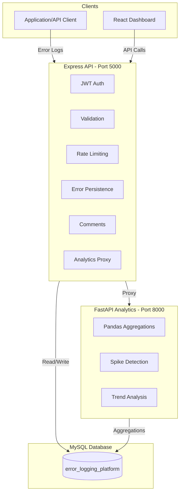

# LogSentinel: Intelligent Application Error Logging, Monitoring & Analytics Platform

<div align="center">


</div>

**Product Name:** LogSentinel  
**Repository:** Error-Logging-Platform (renamed to logsentinel)

A multi-service error logging platform. A React dashboard and an Express API store application errors in MySQL. A separate FastAPI service reads that same database to build severity trends, route breakdowns, and statistical spike reports.

---

## Problem Statement

Application failures are hard to manage when each service writes its own logs:
- Messages sit in separate files/consoles, same failures easy to miss
- Severity inconsistent, critical failures look like noise
- Same exception fires thousands of times, burying first useful stack trace
- Debugging starts with searching raw logs instead of one record with request context
- No shared view of which project, route, or environment is failing
- Counts over time are manual, sudden rise in errors noticed late

LogSentinel addresses this by storing structured error records in MySQL and exposing them through an API and dashboard.

---

## System Architecture



---

## Technology Stack

| Area | Technology | Evidence |
|------|------------|----------|
| Frontend | React 18, React Router 6, React Hook Form, Axios, Chart.js, react-chartjs-2, jwt-decode, date-fns | `frontend/package.json` |
| Frontend Delivery | Create React App (`react-scripts` 5) dev, Nginx production | `frontend/Dockerfile`, `nginx.conf` |
| Backend | Node.js 18+, Express 4, Helmet, CORS, express-validator, express-rate-limit, bcryptjs, jsonwebtoken, mysql2, Axios, dotenv | `backend/package.json` |
| Languages | JavaScript (UI/API), Python (analytics), SQL (schema) | Repository layout |
| Database | MySQL 8, InnoDB, utf8mb4 | `database/schema.sql`, `docker-compose.yml` |
| Cache | Redis 7 Alpine (Compose only - no app client) | `docker-compose.yml` |
| Analytics | FastAPI 0.109, Uvicorn, SQLAlchemy 2, PyMySQL, pandas, NumPy | `analytics/requirements.txt` |
| Authentication | JWT bearer, bcrypt, roles on user row | `backend/src/routes/authRoutes.js` |
| Containerization | Dockerfiles for backend, frontend, analytics. Compose: MySQL, Redis | `docker-compose.yml` |

---

## Key Features

### Implemented & Verified in Source

| Capability | Location |
|------------|----------|
| Centralized error intake | `POST /api/error-logs` inserts into `error_logs` |
| Five severity levels | `critical`, `high`, `medium`, `low`, `info` validated and stored in `error_type` |
| Stack trace & request context | `stack_trace`, URL, method, IP, user agent, params, headers, environment, version, metadata |
| Filtering & pagination | Query filters for level, status, route, date range, project id, message/error-code search |
| Status workflow | `new`, `investigating`, `resolved`, `ignored`. Resolving sets `resolved_at` |
| Comments | Insert and list comments joined to author name |
| Summary counts | Totals by severity, distinct fingerprints, distinct URLs (last 7 days) + 5 recent critical/high |
| JWT authentication | Register, login, `GET /api/auth/me`, token refresh. bcrypt cost 10 |
| Admin-only delete | `DELETE /api/error-logs/:id` returns 403 unless `role = admin` |
| Rate limiting | Auth routes: 10 req/15 min. Error/analytics routes configurable |
| HTTP hardening | `helmet` on Express app |
| Analytics queries | FastAPI routes aggregate MySQL with pandas for hourly/daily counts, routes, severity, spikes, trends |
| Spike calculation | Mean + std by hour-of-day and severity vs last hour |
| Multi-project schema | `projects` table with `owner_id` and `api_key`. Errors reference `project_id` |

### Partially Implemented

| Capability | Status |
|------------|--------|
| React Dashboard | Pages exist but `src/index.js` missing; API helpers not exported |
| Duplicate Detection | MD5 fingerprint logic exists but occurrence columns not in schema |
| Multi-project Monitoring | Errors stored/filtered by `project_id` but no projects router; API key auth not implemented |
| Analytics Dashboard | Chart.js page exists but calls undefined API functions |
| Express-FastAPI Proxy | Implemented but `projectId`/`project_id` mismatch |
| RBAC | Roles exist but `authorize()` not applied to routes; registration accepts client-supplied role |
| Real-time Monitoring | Nginx WebSocket proxy configured but no WebSocket server |
| Notifications | Table and UI checkboxes exist but no delivery implementation |

---

## Technology Stack

| Area | Technology | Evidence |
|------|------------|----------|
| Frontend | React 18, React Router 6, React Hook Form, Axios, Chart.js, react-chartjs-2, jwt-decode, date-fns | `frontend/package.json` |
| Frontend Delivery | Create React App (`react-scripts` 5) dev, Nginx production | `frontend/Dockerfile`, `nginx.conf` |
| Backend | Node.js 18+, Express 4, Helmet, CORS, express-validator, express-rate-limit, bcryptjs, jsonwebtoken, mysql2, Axios, dotenv | `backend/package.json` |
| Languages | JavaScript (UI/API), Python (analytics), SQL (schema) | Repository layout |
| Database | MySQL 8, InnoDB, utf8mb4 | `database/schema.sql`, `docker-compose.yml` |
| Cache | Redis 7 Alpine (Compose only - no app client) | `docker-compose.yml` |
| Analytics | FastAPI 0.109, Uvicorn, SQLAlchemy 2, PyMySQL, pandas, NumPy | `analytics/requirements.txt` |
| Authentication | JWT bearer, bcrypt, roles on user row | `backend/src/routes/authRoutes.js` |
| Containerization | Dockerfiles for backend, frontend, analytics. Compose: MySQL, Redis | `docker-compose.yml` |

---

## Project Structure

```
Error-Logging-Platform/
├── .env.example
├── .gitignore
├── docker-compose.yml
├── backend/
│   ├── Dockerfile
│   ├── package.json
│   └── src/
│       ├── app.js
│       ├── config/          # env config and mysql2 pool
│       ├── controllers/     # error logs and analytics
│       ├── middleware/      # JWT, validation, rate limit, error handler
│       ├── routes/          # auth, error logs, analytics, unmounted user routes
│       ├── services/        # SQL for logs; axios client for FastAPI
│       └── utils/helpers.js
├── analytics/
│   ├── Dockerfile
│   ├── requirements.txt
│   └── app/
│       ├── main.py
│       ├── config.py
│       ├── database.py
│       ├── models.py
│       ├── routes/          # /api/analytics and /api/errors
│       └── services/        # aggregations and spike detection
├── frontend/
│   ├── Dockerfile
│   ├── nginx.conf
│   ├── package.json
│   ├── public/index.html
│   └── src/
│       ├── App.js
│       ├── components/
│       ├── context/
│       ├── charts/ErrorCharts.js
│       ├── pages/
│       ├── services/api.js
│       ├── hooks/useDebounce.js
│       └── utils/format.js
└── database/
    ├── schema.sql
    ├── seed.sql
    └── archive.sql
```

---

## Installation & Setup

### Prerequisites
- Node.js 18+ and npm
- Python 3.10+
- MySQL 8.0 client and server
- Git

### Clone
```bash
git clone https://github.com/samalarakshithbabu/logsentinel.git
cd Error-Logging-Platform
```

### Database
```bash
# Linux/macOS
mysql -u root -p < database/schema.sql
mysql -u root -p < database/seed.sql

# Windows PowerShell
Get-Content .\database\schema.sql -Raw | mysql -u root -p
Get-Content .\database\seed.sql -Raw | mysql -u root -p
```

### Backend (Express API)
```bash
cp .env.example backend/.env
cd backend
npm install
# Edit backend/.env with DB credentials, JWT_SECRET, etc.
npm run dev
# Health check: http://localhost:5000/health
```

### Analytics Service (FastAPI)
```bash
cd analytics
python3 -m venv venv
source venv/bin/activate
pip install -r requirements.txt
pip install python-dotenv
uvicorn app.main:app --reload --host 0.0.0.0 --port 8000
# Health: http://localhost:8000/health, Docs: http://localhost:8000/docs
```

### Frontend (React)
```bash
cd frontend
npm install
# Note: src/index.js is missing - create it to run
npm start
```

### Docker (All Services)
```bash
cp .env.example .env
# Edit .env with all secrets
docker-compose up --build -d
```

---

## API Documentation

### Express Authentication
| Method | Endpoint | Auth | Description |
|--------|----------|------|-------------|
| POST | `/api/auth/register` | No | Create user, return JWT |
| POST | `/api/auth/login` | No | Check bcrypt, return JWT |
| GET | `/api/auth/me` | Bearer | Return user profile |
| POST | `/api/auth/refresh` | Bearer | Sign new token |

### Express Error Logs (All require Bearer token)
| Method | Endpoint | Description |
|--------|----------|-------------|
| GET | `/api/error-logs` | Paginated list with filters |
| GET | `/api/error-logs/summary` | 7-day counts + 5 recent critical/high |
| GET | `/api/error-logs/:id` | Single log with project/assignee names |
| POST | `/api/error-logs` | Validate and insert |
| PATCH | `/api/error-logs/:id/status` | Set status (new/investigating/resolved/ignored) |
| POST | `/api/error-logs/:id/comments` | Add comment as current user |
| GET | `/api/error-logs/:id/comments` | Comments with user_name |
| DELETE | `/api/error-logs/:id` | Delete row (admin only) |

### FastAPI Analytics (No auth)
| Method | Endpoint | Description |
|--------|----------|-------------|
| GET | `/health` | Service status |
| GET | `/api/analytics/hourly` | Counts per hour & severity |
| GET | `/api/analytics/daily` | Counts per day & severity |
| GET | `/api/analytics/routes` | Route & severity counts (7 days) |
| GET | `/api/analytics/severity` | Count & % by severity (7 days) |
| GET | `/api/analytics/top-routes` | Routes ordered by count |
| GET | `/api/analytics/spikes` | Spikes exceeding mean + 3×std |
| GET | `/api/analytics/trend` | First vs second half comparison |
| GET | `/api/analytics/summary` | 7-day totals, severity, open/resolved |

---

## Database Schema

**Database:** `error_logging_platform`  
**Engine:** InnoDB, utf8mb4

```sql
-- Core Tables
users (id, email, password_hash, name, role, is_active, created_at)
projects (id, name, description, api_key, owner_id, is_active)
error_logs (id, project_id, error_code, error_type, message, stack_trace,
            request_url, request_method, end_user_id, user_agent, ip_address,
            request_params, request_headers, environment, version,
            fingerprint, status, assigned_to, resolved_at, metadata,
            created_at, updated_at)
error_events (id, error_log_id, count, occurred_at)
comments (id, error_log_id, user_id, content, created_at)
notifications (id, user_id, type, config, is_active)
audit_logs (id, user_id, action, resource_type, resource_id, old_values, new_values, ip_address, user_agent, created_at)
```

---

## Limitations (Documented)

1. **No live deployment** - Local development only
2. **Frontend entry file missing** - `src/index.js` not in repository
3. **Duplicate detection incomplete** - Occurrence columns not in schema
4. **No API key authentication** for error ingestion
5. **No WebSocket server** for real-time updates
6. **No notification delivery** (email/Slack/webhook)
7. **Redis unused** - Started by Compose but no client
8. **User routes unmounted** - `userRoutes.js` not mounted in `app.js`
9. **Project API missing** - Frontend calls undefined `projectsAPI`
10. **Export not implemented** - UI buttons exist but no backend route

---

## Future Enhancements

- Working email, Slack, and webhook delivery
- API-key authentication for ingest
- Live updates over WebSockets
- Export of error logs (JSON/CSV)
- Enforced role checks on every mutating route
- Wired project-management API
- CI/CD pipeline
- Comprehensive test suite

---

## Author

**SAMALA RAKSHITH BABU**  

**Contact:**  
- Email: samalarakshithbabu7@gmail.com  
- LinkedIn: https://www.linkedin.com/in/samala-rakshith-babu/  
- GitHub: https://github.com/samalarakshithbabu  

---

## License

MIT License